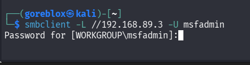

# Simulando-um-Ataque-de-Brute-Force

Este projeto e a documentação de um ataque simulado em uma rede interna com o intuito de reforçar politicas de segurança como senhas complexas, configuração de firewalls e monitoramento de logs.

As ferramentas utilizadas foram os sistemas operacionais `kali linux` e o `metasploitable 2` que é um sistema operacional linux propositalmente vulneravel para testes de penetração. As ferramentas de enumeração e brute force utilizadas foram respectivamente o `nmap` e o `medusa`.

## Brute force em protocolo FTP

Neste exemplo iremos criar dois arquivos txt um contendo o uma lista de possiveis usuarios e um com possiveis senhas, estas listas são obtidas atraves de levantamento de hipoteses estatisticas ou vazamentos previos, iremos criar arquivos txt com poucos itens apenas para demonstração mas normalmente listas de de senhas e usuarios possuem milhares ou milões de itens. Em seguida utilizaremos o medusa com estes arqivos de texto para realizar um ataque de força bruta e descobrir o login através do protocolo FTP.

### Criando listas

Para criar a lista de usuarios utilizaremos no terminal do nosso Kali linux utilizamos o comando:
```
echo -e "user\nmsfadmin\nadmin\nroot" > pass.txt
```
O que são os parametros do codigo acima?
    
`echo -e` echo é representa a saida padrao do terminal geralmente utilizado  para exibir mensagens na tela, neste caso esta sendo utilizado com a flag `e` para interpretar qubras de linha `\n`
`parametros entre aspas "admin\.."` texto para ser encaminhado para a saida padrao do terminal, lembre se o `\n` sera intepretado como quebra de linha.
`|` tambem conhecido como pipe serve para passarmos a saida do ultimo comando como parametro para comando seguinte
`>` salva a saida anterior no arquivo txt `users.txt`

acabamos de criar um arquivo de texto chamado `users.txt` como seguinte conteudo:
```
user
msfadmin
admin
root
```
Seguindo a mesma logica, iremos criar um arquivo pass.txt para criar uma lista de senhas utilizando o seguinte codigo:
```
echo -e "123456\npassword\nquerty\nmsfadmin" > pass.txt
```

### Utilizando o medusa para descobrir o login

No terminal do Kali iremos rodar o `medusa` com o seguinte comando:
```
medusa -h 192.168.123.456 -U users.txt -P pass.txt -M ftp -t 6
```
`medusa` inicia o aplicativo medusa
`-h` indica o alvo, neste caso o IP ficticio (192.168.123.456)
`-U` parametro para indicar o arquvivo contendo a lista de usuarios
`-P` parametro para indicar o arquvivo contendo a lista de senhas
`-M` Modo, indica o modo utilizado, neste caso o ftp
`-t` indica o numero de threads que sera utilizado para o teste de força bruta

Ao terminarmos de rodar o comando obtivemos o seguinte resultado:

podemos ver que temos um login com sucesso e a combinação utilizada foi user:msfadmin senha:msfadmin,agora que sabemos a senha podemos testar conexao utilizando:
```
ftp 192.168.123.456
```
`ftp` irá indicar a conexao que queremos realizar 
ele ira pedir senha e login, entao vamos inserir a que conseguimos utilizando o medusa, user:msfadmin senha:msfadmin. Sucesso, estamos logados!!!

## Brute force em formulario web
Agora iremos simular um Brute force no formulario web DMVWA (Damn Vulnerable Web Application),

### Descobrindo parametros
primeiro iremos acessar em nosso navegador no Kali o formulario web buscando por `192.168.123.456/dwa/login.php` então para obter mais informações vamos apertatar a tecla F12 para entrar no modo desenvolvedor, iremos realizar uma tentativa de login qualquer, neste exemplo utilizei user:user e senha:user, podemos clicar em sima da primeira requisição post e entao em Request, com esta informação podemos descobrir o nome dos parametros passados para o Request, ou seja utilizando os parametros username, password, Login, podemos repassar estes parametros para realizar as tentativas de forma automatizada e identificar se a tentativa foi bem sucedida ou não.


### Utilizando o medusa para brute force
Para este formulario web iremos utilizar os mesmos arquivos txt criados anteriormente (pass.txt e users.txt ) para realizar as tentativas. iremos utilizar o seguinte comando:
No terminal do Kali iremos rodar o `medusa` com o seguinte comando:

```
medusa -h 192.168.123.456 -U users.txt -P pass.txt -M http \
-m PAGE:'dvwa/login.php' \
-m FORM:'username=^USER^&password=^PASS^&Login=Login' \
-m 'FAIL=Login failed' -t6
```

`medusa` inicia o aplicativo medusa
`-h` indica o alvo, neste caso o IP ficticio (192.168.123.456)
`-U` parametro para indicar o arquvivo contendo a lista de usuarios
`-P` parametro para indicar o arquvivo contendo a lista de senhas
`-M` Modo, indica o modo utilizado, neste caso o http
`-m` indica que o parametro a ser passado para o modulo
`-t` indica o numero de threads que sera utilizado para o teste de força bruta
`-m PAGE:'dvwa/login.php' \` indica a localização do formulario web
`-m FORM:'username=^USER^&password=^PASS^&Login=Login' \` indica os parametros a serem passados para os parametros do formulario 
`-m 'FAIL=Login failed' -t6` inica o caso em que o formulario retorna falha, essencial para identificar um login de sucesso ou falha.

Saída:

Podemos notar que temos muitas tentativas e muitos [SUCESS] mas apenas a primeira aparição do sucess indica a combinação de senha e usuario que gerou o login, podemos testar este login no formulario web e podemos ver que funciona.
## Password spraying em SMB e enumeração de usuarios
Agora iremos utilizar a técnica de enumeração que se trata de um levantamento de informações de um um sistema, podemos decobrir coisas como usuários e grupos por exemplo, em seguida vamos usar o password Spraying que consiste em testar uma senha por vez para vários usuarios de uma lista, o password sprayin se mostra muito vantajoso por conta do seu baixo ruido comparado a outros metodos mais comuns, por testar logins em vários usuarios acaba sendo mais dificil de detectar ou de gerar um bloqueio de tentativas em um usuário.

### Enumeração
Para enumerarmos a nossa vitima iremos utilizar:
```
enum4linux -a 192.168.123.456 | tee enum4_output.txt
```
`enum4linux` programa utilizado para realizar enumeração
`-a` indica para o programa realizar toda a enumeração basica
`tee enum4_output.txt` salva a saida em um arquivo txt chamado `enum4_output.txt`
 
Ao rodar o codigo podemos obter informações como usuarios e grupos e usuarios que nos ajudam muito ao realizar tentativas de login:

podemos utilizar o comando 
```
less enum4_output.txt
````
para ver a saida e utilizar as teclas (up_arrow e dwn_arrow) para navegar e utilizar a tecla q para sair.

### Sprayin no serviço SMB
Agora que descobrimos vários usuarios do sistema a proxima etapa é criar uma wordlist com o nome dos usuários descobertos, apenas para fins demontrativos irei utilizar apenas alguns nomes de usuários e armazenar em uma lista `smb_users.txt` e uma lista de senhas `senhas_spray.txt`:
```
echo -e "user\nmsfadmin\nservice" > smb_users.txta
echo -e "123456\nmsfadmin\npassword\nWelcome123" > senhas_spray.txt
```
Para realizar o Sprayin vamos novamente utilizar o medusa:
```
medusa -h 192.168.123.456 -U smb_users.txt -P senhas_spray.txt -M smbnt -t 2 -T 50
```
`-M smbnt` indica que o módulo a ser utilizado é para o protocolo SMB
`-T`indica o numero de hosts a serem testados em paralelo

Saída:

podemos notar que há uma linha contendo `ACCOUNT FOUND` e `[SUCCESS (ADMIN$ - Access Allowed)]` que indica que o nosso usuario logou com sucesso e também é um administrador, esta linha também contem informções da senha utilizada(msfadmin) e usuário(msfadmin).
Agora vamos testar se o login é valido na prática
```
smbclient -L //192.168.123.456 -U msfadmin
```
`smbclient -L` utilizado para realizar uma conexão de login com o serviço SMB
`-U msfadmin` indica o nome de usuario
Saída:

Agora inserimos a senha (msfadmin):

Conseguimos realizar o login com sucesso!!!

## Conclusão
Nestas três simulações de ataque podemos notar um padrão de que reforçã a nossa atenção para um detalhe importante que é a falta de segurança, boa parte destes ataques poderia ser evitada com politicas de senhas fortes que impediriam os usuarios de inserirem senhas como por exemplo "123456", outro fator importante é a falta de firewall ou bloqueio de ip/usuário, realizamos múltiplas tentativas de login vindo de um mesmo úsuario e em um único IP e em nenhum momento fomos barrados.
Com este teste podemos notar que mesmo com ferramentas simples conseguimos informações críticas por conta de falta de configuração básica, portanto concluimos este projeto com a seguinte mensagem "USEM SENHAS FORTES".